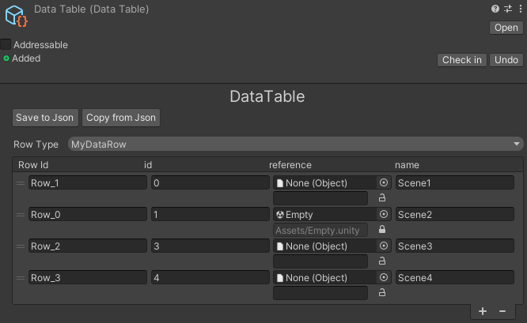
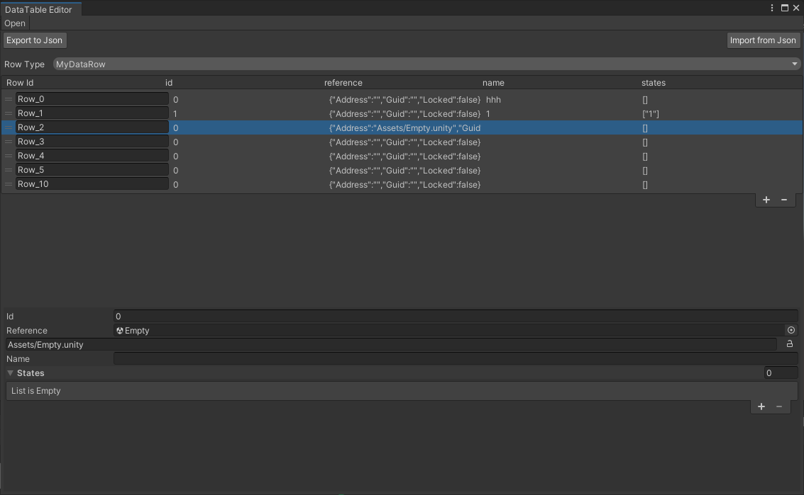

# Data Driven

The Data Driven module stores typed rows in Data Tables. A table is authored as a
`.datatable` text file and imported as a binary `DataTable` asset that the Ceres
Resource system loads at runtime. Row schemas remain C# types, while designers
edit rows in the Inspector or Data Table window.

Use a Data Table for keyed, project-authored records such as items, levels, or
characters. Tables are read-only at runtime. Use Configs for process-wide
settings and live overrides.

## Define a Row Schema

A row is a serializable class implementing `IDataTableRow`:

```csharp
using System;
using Ceres.DataDriven;

[Serializable]
[AddressableDataTable(
    group: "GameData",
    address: "items",
    Labels = new[] { "runtime-data" })]
public sealed class ItemRow : IDataTableRow, IValidateRow
{
    public string displayName;
    public int maxStack = 1;

    [EditorOnly]
    public string designerNote;

    public bool ValidateRow(string rowId, out string reason)
    {
        if (maxStack > 0)
        {
            reason = null;
            return true;
        }

        reason = "maxStack must be greater than zero";
        return false;
    }
}
```

Persisted members follow Unity's serialization rules, and rows need no
serialization attributes: Ceres generates the encoding of each row type and the
types it contains at compile time. A type with non-public persisted members must
be declared `partial`; otherwise compilation reports the type and member.
Members marked `[EditorOnly]` stay in the `.datatable` file and are omitted from
the runtime table, which suits Editor-only notes. Mark every persisted member
that exists only under `UNITY_EDITOR` this way. Reference assets with
`SoftAssetReference` or `SoftAssetReference<T>`; a row cannot hold
`UnityEngine.Object` fields.

`IValidateRow` is optional. Validation runs on import, and a failing row is
reported as an import warning. `AddressableDataTableAttribute` is also optional:
`DataTableEditorUtils.RegisterTableToAssetGroup` and
`RegisterAllDataTablesToAssetGroup` register tables whose row type has it in the
specified Addressables group. The address defaults to the file name when
`Address` is omitted; labels come from `Labels`.

## Author a Table

1. Select **Assets > Create > Ceres > DataTable** to create a `.datatable` file.
2. Select the file and choose `ItemRow` as the row type.
3. Add rows and assign a unique row ID to each record.
4. Edit inline or double-click the table to open the Data Table window.





Edits are kept in a document until **Save**. Closing the Inspector or window
saves pending edits. Saving writes the `.datatable` file and reimports the
table. The Inspector and the window share one document for the same file.

The source is UTF-8 JSON with one object per row:

```json
{
  "rowType": "Game.ItemRow, Assembly-CSharp",
  "rows": [
    {
      "id": "potion",
      "data": {
        "displayName": "Potion",
        "maxStack": 10,
        "designerNote": ""
      }
    }
  ]
}
```

Members missing from a row take their default values, and members unknown to
the row type are ignored. Changing a row type reimports every table that uses
it. **Import from Json** and **Export to Json** read and write this format.

Import fails, and produces no table, when the file is not valid JSON, names an
unknown row type, repeats a row ID, or contains a member that cannot be encoded.
The Console names the table, row and member.

## Read Rows

`DataTable` exposes typed and untyped lookup APIs:

```csharp
ItemRow potion = table.GetRow<ItemRow>("potion");
ItemRow first = table.GetRow<ItemRow>(0);
ItemRow[] stackable = table.GetRows<ItemRow>(row => row.maxStack > 1);
ItemRow[] all = table.GetAllRows<ItemRow>();
```

`GetRow<T>(string)` returns `null` when the ID is absent, and `ContainsRow` and
`GetRowIndex` test an ID. Index-based access uses the authored order and throws
for an invalid index. `GetRowMap()` creates a dictionary keyed by row ID.

Rows decode on first access and are cached by the table. Treat them as
read-only; the runtime table has no mutation API.

A table built against an earlier version of its row type, such as one in a
separately built content package, still reads. Members are matched by name:
members added since take their initial values, and members that were removed or
changed type are ignored. Tables in the project are always current because
changing a row type reimports them.

## Load Tables with a Manager

Derive from `DataTableManager<TManager>` to own a set of Addressable tables. A
concrete manager needs the public object constructor used by discovery.

```csharp
using Ceres.DataDriven;
using Cysharp.Threading.Tasks;

public sealed class GameData : DataTableManager<GameData>
{
    public GameData(object _) : base(_) { }

    protected override UniTask Initialize(bool sync)
    {
        return InitializeSingleTable("items", sync);
    }

    public ItemRow GetItem(string rowId)
    {
        return GetDataTable("items")?.GetRow<ItemRow>(rowId);
    }
}
```

Initialize managers explicitly when their data is required:

```csharp
await DataTableManager.InitializeAsync();
ItemRow item = GameData.Get().GetItem("potion");
```

`InitializeAsync()` first registers every discovered concrete manager, then
initializes the pending managers in parallel. Concurrent callers await the same
initialization, and managers from assemblies loaded later are added without
reloading managers that already completed. `Initialize()` uses the same
two-phase discovery with synchronous Addressables completion.

`Get()` is valid after initialization completes. It never enters synchronous
initialization while an asynchronous initialization is active. `ReleaseAll()`
invalidates the active initialization generation and clears the manager
registry, so late completions cannot publish stale state.

`InitializeSingleTable` loads through `ResourceSystem`. When
`DataDrivenConfig.ValidateDataTableBeforeLoad` is enabled, it first verifies the
address. A missing resource is ignored by the helper and the table remains unregistered.

Enable **Initialize Managers** in **Project Settings > Ceres** only when every
manager should load before normal gameplay. Otherwise initialize the required
managers from the project's own startup flow.

## Editor Scripting

Editor tools change tables through `DataTableDocument`, never through the
imported `DataTable`. `DataTableEditorUtils` covers the common cases:

```csharp
DataTable table = DataTableEditorUtils.CreateDataTable("Assets/Data/Items.datatable", typeof(ItemRow));

DataTableEditorUtils.Edit(table, document =>
{
    document.AddOrUpdateRow("potion", new ItemRow { displayName = "Potion", maxStack = 10 });
});
```

`Edit` saves the table when the edit changed it. Inside `BeginBatch()`, edits to
the same table share one document and every changed table saves and imports
together when the scope ends:

```csharp
using (DataTableEditorUtils.BeginBatch())
{
    foreach (var item in importedItems)
        DataTableEditorUtils.Edit(table, document => document.AddOrUpdateRow(item.Id, item.Row));
}
```

Read rows for Editor tooling with `DataTableEditorUtils.GetAllRowsSafe` or
`GetRowMapSafe`. They return copies read from the `.datatable` file, including
`[EditorOnly]` members such as the asset GUID of a soft reference, which the
runtime table does not contain.

`DataTableDocument.Open` returns the document already open for a file, so tools
and editors share pending edits. Release a document with `Dispose`, or with
`Close(true)` to save pending edits when the last holder releases it.

For a custom window, derive behavior from `DataTableEditorExtension` and open it
with `DataTableEditorWindow.OpenWindowWithExtensions`. `OnDataTablePreUpdate`
and `OnDataTablePostUpdate` observe edits made in the editors.

Related API: <xref:Ceres.DataDriven.DataTable>,
<xref:Ceres.DataDriven.DataTableManager>,
<xref:Ceres.DataDriven.DataTableManager%601>,
<xref:Ceres.DataDriven.Editor.DataTableDocument>, and
<xref:Ceres.DataDriven.Editor.DataTableEditorUtils>.
