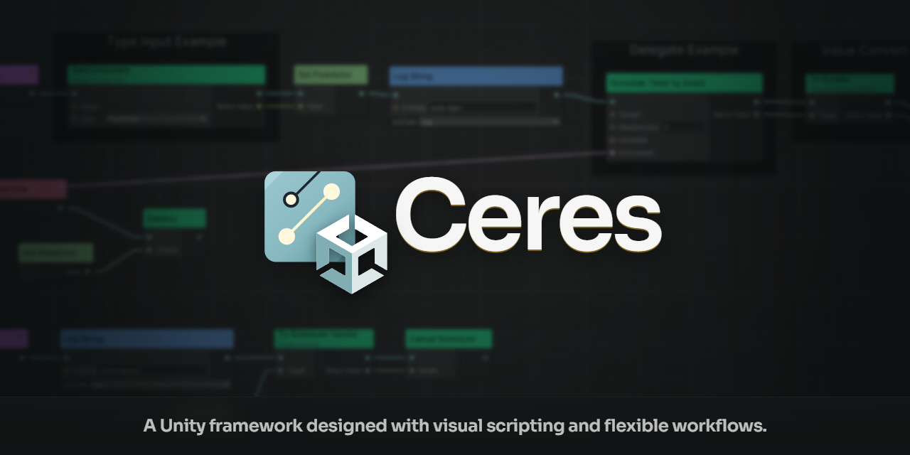
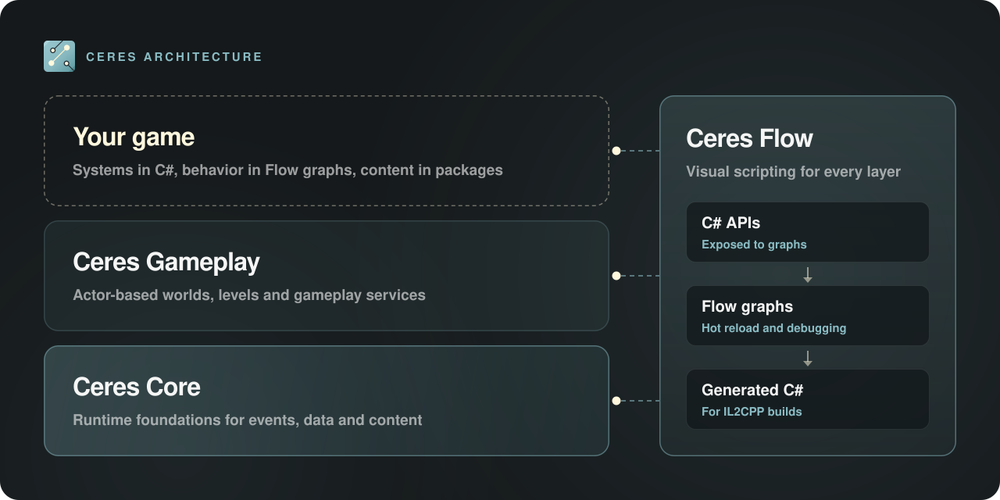
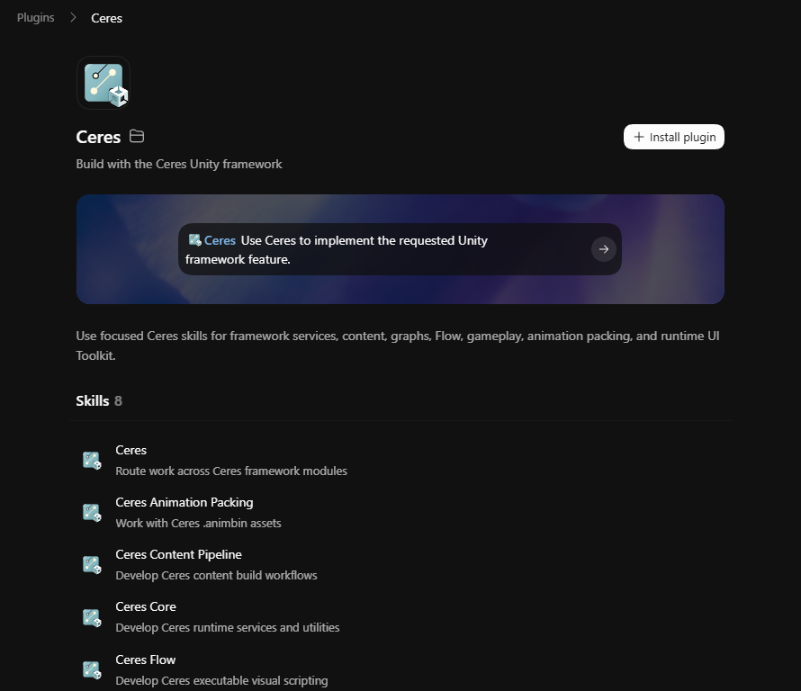
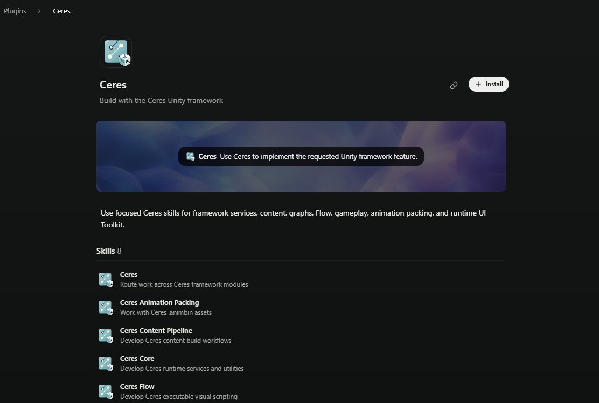
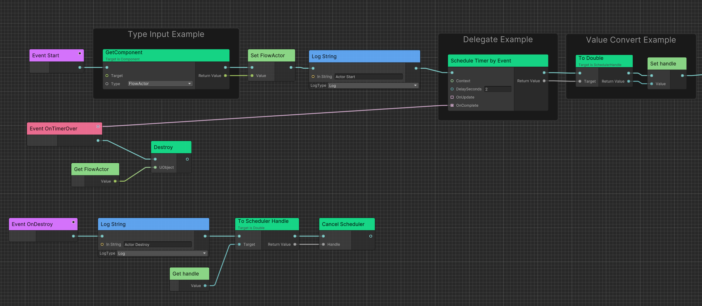

<div align="center">

[](https://github.com/AkiKurisu/Ceres/releases)
[](./LICENSE)
[](https://www.zhihu.com/people/akikurisu)
[](https://space.bilibili.com/20472331)



Ceres is my personal Unity framework designed with visual scripting and flexible workflows.

> Ceres began with my indie games and student projects rather than commercial development, and I have kept evolving it since my student days into the foundation of my Unity projects. I hope you like it.

</div>

## Why Ceres?

Ceres is a C#-first Unity framework: write systems in C#, compose and iterate them in visual scripting, and ship generated C# where performance matters.



- **C#-first visual scripting:** expose C# APIs to Flow graphs, debug and hot-reload them, and generate C# for IL2CPP builds.
- **Actor-based gameplay:** a lightweight world of Actors, Components and lifecycle-managed services that projects extend.
- **Data-driven iteration:** typed data tables and layered configs, tunable live through console variables.
- **Production pipeline:** deterministic Addressables content builds, validated updates and runtime-mounted packages.

## Platforms

Ceres requires Unity 2022.3 LTS or later and is developed on Unity 6.

## Install

### Unity package

1. Install [NuGetForUnity](https://github.com/GlitchEnzo/NuGetForUnity) through Unity Package Manager with:

   ```text
   https://github.com/GlitchEnzo/NuGetForUnity.git?path=/src/NuGetForUnity
   ```

2. Open **NuGet > Manage NuGet Packages** and install `R3` version `1.3.0` and `MessagePack` version `3.1.4`.

3. Add UniTask, MessagePack for Unity and Ceres to your project's `Packages/manifest.json`:

```json
"dependencies": {
    "com.kurisu.ceres": "https://github.com/AkiKurisu/Ceres.git?path=Packages/com.kurisu.ceres",
    "com.cysharp.unitask": "https://github.com/Cysharp/UniTask.git?path=src/UniTask/Assets/Plugins/UniTask#2.5.3",
    "com.github.messagepack-csharp": "https://github.com/MessagePack-CSharp/MessagePack-CSharp.git?path=src/MessagePack.UnityClient/Assets/Scripts/MessagePack#v3.1.4"
}
```

See [Getting Started](https://akikurisu.github.io/Ceres/docs/getting_started.html) for the complete installation flow.

### Agent plugin

Help coding agents work with Ceres.

#### Codex

1. Open **Plugins**, then select **Add a marketplace** from the **Add** menu.
2. Enter `AkiKurisu/Ceres` under **Source**, then add the marketplace.
3. Find and install **Ceres**.



#### DotCraft

1. Open **Plugins**, then select **Add marketplace** from the menu beside **Create**.
2. Enter `AkiKurisu/Ceres` as the marketplace source, then add it.
3. Open **Ceres**, select **Install plugin**, and add it to the current workspace.



## Documentation

- [Documentation](https://akikurisu.github.io/Ceres/)
- [Getting Started](https://akikurisu.github.io/Ceres/docs/getting_started.html)
- [Ceres Core](https://akikurisu.github.io/Ceres/docs/ceres_concept.html)
- [Ceres Flow](https://akikurisu.github.io/Ceres/docs/flow_startup.html)
- [Ceres Gameplay](https://akikurisu.github.io/Ceres/docs/gameplay.html)
- [Scripting API](https://akikurisu.github.io/Ceres/api/Ceres.html)

## Modules and Ecosystem

### Ceres Core

The runtime foundation every Ceres module builds on: events, data and content.

See [Ceres Core](https://akikurisu.github.io/Ceres/docs/ceres_concept.html).

### Ceres Flow



Event-driven visual scripting built on your C# APIs.

See [Startup Flow](https://akikurisu.github.io/Ceres/docs/flow_startup.html).

### Ceres Gameplay

A lightweight, Actor-based gameplay layer for worlds, levels and the services games share.

See [Gameplay](https://akikurisu.github.io/Ceres/docs/gameplay.html).

### Next Gen Dialogue


AI-powered dialogue visual designer for Unity.

See [Next-Gen-Dialogue](https://github.com/AkiKurisu/Next-Gen-Dialogue).

## Articles

Technique articles related to Ceres.

### Design

[如何设计一个Unity可视化脚本框架（一）](https://zhuanlan.zhihu.com/p/20500696157)

[如何设计一个Unity可视化脚本框架（二）](https://zhuanlan.zhihu.com/p/20711259559)

[如何设计一个Unity可视化脚本框架（三）](https://zhuanlan.zhihu.com/p/23323693948)

### Performance

[让Unity IL2CPP下的反射性能提高100倍的方法](https://zhuanlan.zhihu.com/p/25806713882)

## License

[MIT](./LICENSE)
